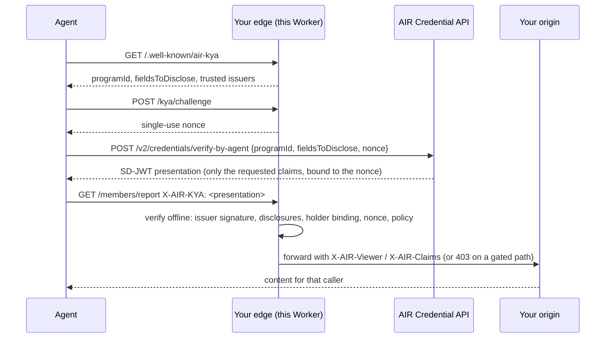

# AIR KYA Edge

**Know Your Agent (KYA) at the Cloudflare edge.** A Worker that sits in front of any site and checks the AIR credential an AI agent presents, before the request reaches your origin. Use it to **gate** content to verified agents, or to **triage** every caller into a class your origin can act on.

Full guide: [docs.air3.com/products/agents/edge-gating-cloudflare](https://docs.air3.com/products/agents/edge-gating-cloudflare)



The edge never calls AIR per request and never trusts a status relayed by the agent. It verifies the issuer-signed presentation itself.

## How callers are classified

| Caller sends | `X-AIR-Viewer` | `gate` path | `triage` path |
| --- | --- | --- | --- |
| No `X-AIR-KYA` header | `anonymous` | 403 | forwarded |
| A proof that fails any check | `ineligible` | 403 | forwarded |
| A valid proof that meets the policy | `eligible` | forwarded, with claims | forwarded, with claims |

`anonymous` means "sent no proof". It is not a proof of humanity: people and unverified bots both land there. Combine it with Cloudflare Bot Management if you need that distinction.

## Quickstart (local, no AIR account needed)

Requires Node 20+.

```sh
npm install
npm run setup     # creates a local test issuer and .dev.vars that trusts it
npm run origin    # terminal 1: example origin on :8788
npm run dev       # terminal 2: the edge on :8787
```

Then, in a third terminal:

```sh
curl -s http://127.0.0.1:8787/pricing                                        # anonymous, forwarded
curl -s http://127.0.0.1:8787/members/report                                 # anonymous, 403
npm run agent -- http://127.0.0.1:8787/members/report --fixture              # Gold → eligible, 200
npm run agent -- http://127.0.0.1:8787/members/report --fixture --tier Silver  # 403 condition_not_met:tier
npm run agent -- http://127.0.0.1:8787/members/report --fixture --replay     # second use → nonce_reused_or_unknown
npm run agent -- http://127.0.0.1:8787/pricing --fixture                     # triage: origin serves member prices
```

`--fixture` signs credentials with the local test issuer instead of calling AIR. Everything else, including the edge checks, is the production path.

## Configure it for your site

Edit [`kya.config.ts`](kya.config.ts):

```ts
export const policy = (env: Env) =>
  definePolicy({
    programId: env.KYA_PROGRAM_ID,                 // your AIR verification program
    trustedIssuers: list(env.KYA_TRUSTED_ISSUERS), // issuer DIDs you accept
    vct: env.KYA_VCT,                              // credential type you accept
    fieldsToDisclose: ["tier"],                    // exactly what the agent must disclose
    conditions: [{ attribute: "tier", operator: "in", value: ["Gold", "Platinum"] }],
  });

export const rules: Rule[] = [
  { path: "/members/*", mode: "gate" },   // only eligible callers get through
  { path: "/assets/*", mode: "off" },     // no check
  { path: "/*", mode: "triage" },         // everyone gets through, labelled
];
```

Operators: `=`, `!=`, `>`, `>=`, `<`, `<=`, `in`. Every condition attribute must be in `fieldsToDisclose`.

Set the IDs as Worker vars in [`wrangler.jsonc`](wrangler.jsonc), and the origin secret as a secret:

```sh
npx wrangler secret put KYA_ORIGIN_SECRET
npm run deploy
```

| Var | Purpose |
| --- | --- |
| `KYA_PROGRAM_ID` | AIR verification program ID (Dashboard → Verifier → Programs). Also the expected `aud` of the key-binding JWT. |
| `KYA_TRUSTED_ISSUERS` | Comma-separated issuer DIDs (`did:web:…`). Their DID documents are fetched over HTTPS and cached for 5 minutes. |
| `KYA_VCT` | Accepted credential type. |
| `KYA_PINNED_DIDS` | Optional JSON array of DID documents to use without fetching. `npm run setup` uses it for the test issuer. |
| `ORIGIN_URL` | Optional. Empty: forward to the zone's own origin (Worker on a route in front of your site). Set it to proxy another host, for example while testing on `workers.dev`. |
| `KYA_ORIGIN_SECRET` | Secret sent to the origin as `X-KYA-Origin-Secret`. |

## What your origin receives

The edge removes every caller-supplied `X-AIR-*` header (and the proof itself), then adds:

| Header | Value |
| --- | --- |
| `X-AIR-Viewer` | `anonymous`, `ineligible` or `eligible` |
| `X-AIR-Reason` | Why (see below) |
| `X-AIR-Claims` | Eligible only: the disclosed claims as base64url JSON, e.g. `{"tier":"Gold"}` |
| `X-KYA-Origin-Secret` | Your shared secret, so the origin can refuse traffic that skipped the edge |

Lock the origin to the edge. [`examples/origin.ts`](examples/origin.ts) shows the check:

```ts
const digest = (v: string) => createHash("sha256").update(v).digest();
const fromEdge = (sent: string | undefined) => !!sent && timingSafeEqual(digest(sent), digest(SECRET));
```

On Cloudflare-proxied origins you can use Authenticated Origin Pulls or a Cloudflare Tunnel instead.

## Reason codes

| Reason | Meaning |
| --- | --- |
| `no_credential` | No `X-AIR-KYA` header |
| `policy_satisfied` | Eligible |
| `policy_not_configured` | Program, issuers or vct missing; see `/.well-known/air-kya` |
| `invalid_credential` | Malformed, bad issuer signature, or tampered disclosure |
| `untrusted_issuer` | Issuer not in `trustedIssuers` |
| `did_unresolvable`, `did_mismatch`, `unknown_kid` | Issuer key could not be found in its DID document |
| `expired` | Credential expired |
| `unexpected_vct` | Wrong credential type |
| `disclosure_mismatch` | Disclosed claims are not exactly `fieldsToDisclose` |
| `holder_binding_required` | No key-binding JWT, or no holder key in the credential |
| `invalid_holder_binding` | Key-binding JWT signature, `aud`, age or `sd_hash` is wrong |
| `nonce_reused_or_unknown` | The nonce was not issued here, expired, or already used |
| `condition_not_met:<claim>` | Verified, but the policy condition on `<claim>` failed |

## What the edge checks, in order

1. Issuer is in `trustedIssuers`; its ES256 key comes from its `did:web` document (`assertionMethod`, matching `kid`).
2. Issuer signature, `iat`/`exp`, and `vct`.
3. Disclosed claims are exactly `fieldsToDisclose`, and each matches a digest the issuer signed.
4. Key-binding JWT is signed by the holder key in `cnf.jwk`, `typ` is `kb+jwt`, `aud` is the program ID, it is at most 5 minutes old, and `sd_hash` covers this presentation.
5. The nonce was issued by this site and is consumed now (Durable Object, atomic).
6. Policy conditions on the disclosed claims.

These follow [Verify SD-JWT on your backend](https://docs.air3.com/products/identity/verify-sd-jwt).

## Layout

```
kya.config.ts       policy and rules: the file you edit
src/index.ts        the Worker: discovery, challenge, classify, gate or forward
src/proxy.ts        what the origin receives, and the gate refusal
src/rules.ts        path → gate | triage | off
src/kya/            the reusable KYA module (no Cloudflare imports except nonce.ts)
  index.ts            createKya({ policy, resolveDid, consumeNonce }).classify(request)
  verify.ts           the six checks above
  policy.ts           policy type and conditions
  did.ts              did:web resolution and issuer keys
  nonce.ts            single-use nonce Durable Object
  discovery.ts        /.well-known/air-kya
dev/                local test issuer and setup (never deployed)
examples/agent.ts   an agent: discovery → challenge → verify-by-agent → request
examples/origin.ts  an origin: secret check and triage by X-AIR-Viewer
test/               unit tests for every rejection and the proxy rules
```

`src/kya` runs anywhere with `fetch` and Web Crypto. To use it in another runtime (Express, Next.js middleware, Deno), pass your own `consumeNonce` backed by a store with an atomic delete (Redis `GETDEL`, a database row).

## With a real AIR agent

1. In the AIR Dashboard, create an SD-JWT verification program for the credential you accept, and note the program ID, issuer DID and `vct`.
2. Put them in `wrangler.jsonc` vars and deploy.
3. Give your agent a session token as described in [Using Agentic Identity](https://docs.air3.com/products/agents/partner-agent-api), then:

```sh
AIR_AGENT_JWT=<agent session token> npm run agent -- https://your-site.example/members/report
```

## Before production

- **Revocation is not checked.** Add a Token Status List check if your issuer publishes one.
- **Rate-limit `/kya/challenge`** with a Cloudflare rate-limiting rule; each call stores a nonce for 60 seconds.
- **One nonce per request.** A proof is single-use. For high traffic, shard the nonce store (`getByName` on a prefix of the nonce).
- **Never cache across classes.** Responses to callers with a proof are sent `private, no-store`, and the edge fetches them with `cache: "no-store"`. Keep origin caching keyed on `X-AIR-Viewer` if you add your own.
- **The proof binds to the nonce, not to the HTTP request.** Request signing (Web Bot Auth / RFC 9421) is out of scope.

## Going further

[`mocaverse/air-kya`](https://github.com/mocaverse/air-kya) is a full demo store built on the same checks, including person sign-in with AIR Kit (people verify the same credential in the browser) and a live sandbox deployment.

## Scripts

| Script | What it does |
| --- | --- |
| `npm run setup` | Create the local test issuer and `.dev.vars` |
| `npm run dev` | Run the edge on :8787 |
| `npm run origin` | Run the example origin on :8788 |
| `npm run agent -- <url> [--fixture] [--tier X] [--replay] [--no-proof]` | Run the example agent |
| `npm test` / `npm run typecheck` | Unit tests / types |
| `npm run build` / `npm run deploy` | Dry-run bundle / deploy |
